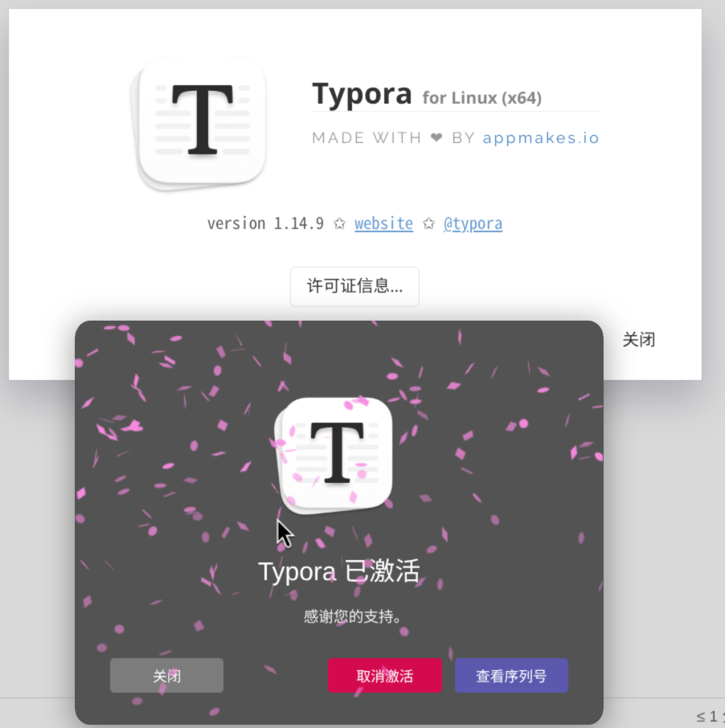

# 1 · 何以起源

最后更新：2026-11-15

Nota 的起源来自对 Typora 的些许不满。

Typora 是一款好软件，我也为其支付了 14.99 美元。

但是其问题也有。不只是老生常谈的 Electron 臃肿问题，还有很多地方会让人感到平台体验并不一致：Typora 在 macOS 上使用了原生 Cocoa 菜单、窗口与系统外观集成，所以整体更接近原生应用；到了 Windows，大部分可见界面由 Electron 的网页层自绘，跨平台的割裂感就明显了许多。Linux 用户相对更少，平台适配自然也就更容易被排在后面。

再看看其他实现，比如 MarkText。社区里对它有很高评价，打开后才发现它同样基于 Electron……

嗯好吧，刚好我没啥事，也有点小AI额度，干脆开干吧。
