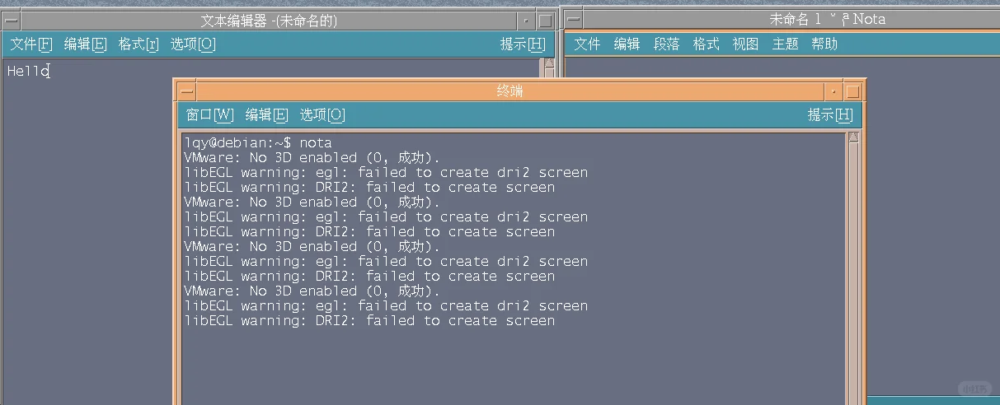

# 2 · CDE 主题从哪里来

最后更新：2026-11-15

这是个很好玩的主题。

[CDE](https://zh.wikipedia.org/wiki/CDE) 是二十世纪九十年代流行的 Linux 桌面环境，大量用于 Sun 工作站、IBM 工作站等设备。年龄比较大的技术读者或许听过或用过它。作为一〇后，我当然没有用过 Sun 工作站，但 CDE 已经开源（见 <https://sourceforge.net/projects/cdesktopenv/>），于是我在 Debian 上编译了几次，还提交了一个相应的[中文补丁](https://sourceforge.net/p/cdesktopenv/code/ci/308891f74a36857b5a0cfe850487a2760413efb9/)。对一个复古爱好者来说，这种诱惑很难抗拒。

CDE 自带一个类似记事本的文本编辑器，配色很经典。分析 CDE 源码之后，我们终于做出了一个还原度很高的 Nota 主题。

就这么简单。当然这个主题很久没有更新过了，我打算最近再更新一下。
